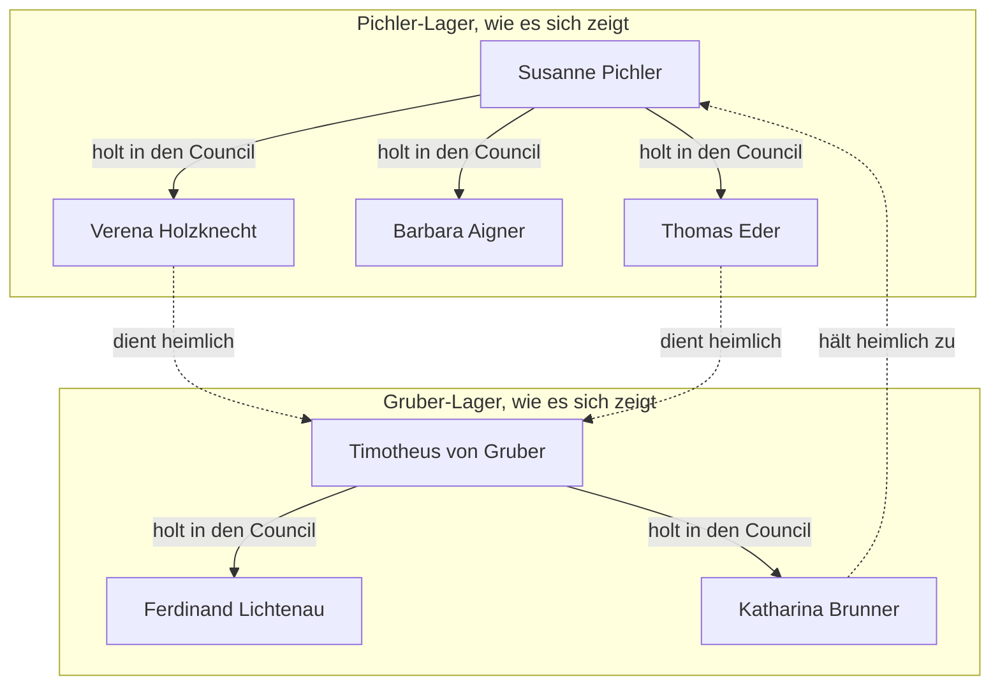
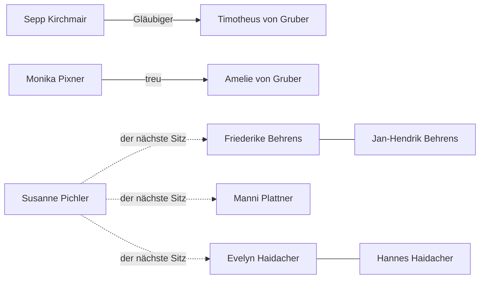
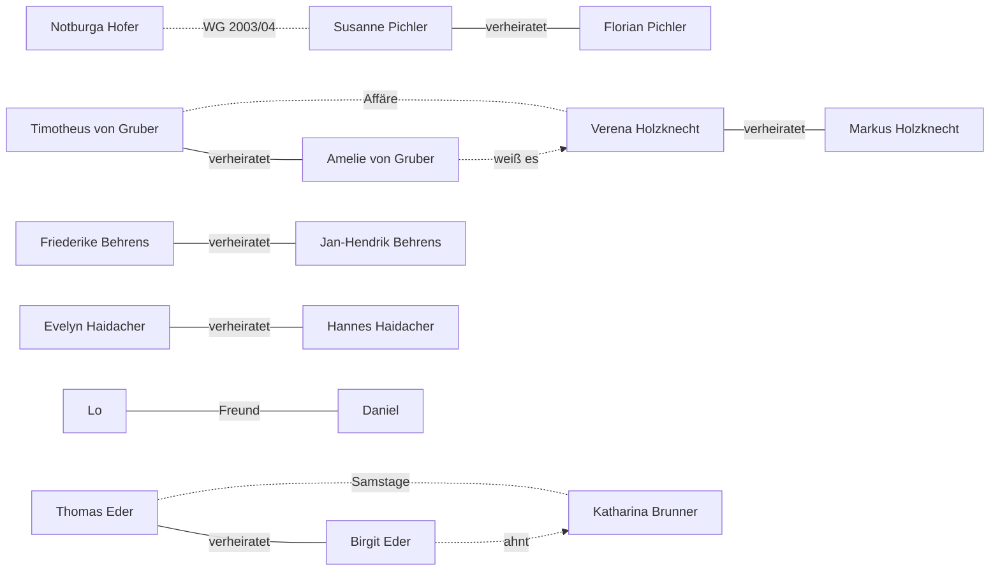
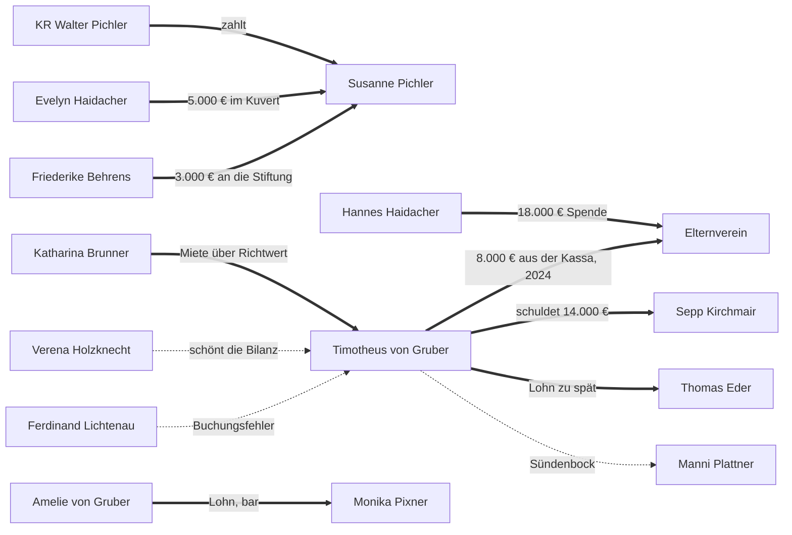
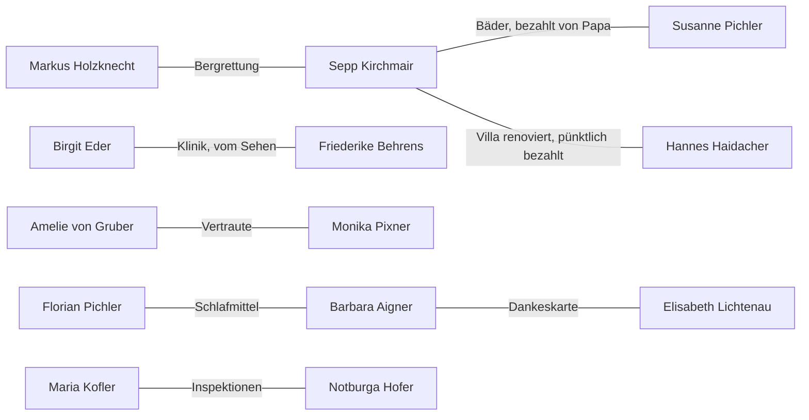
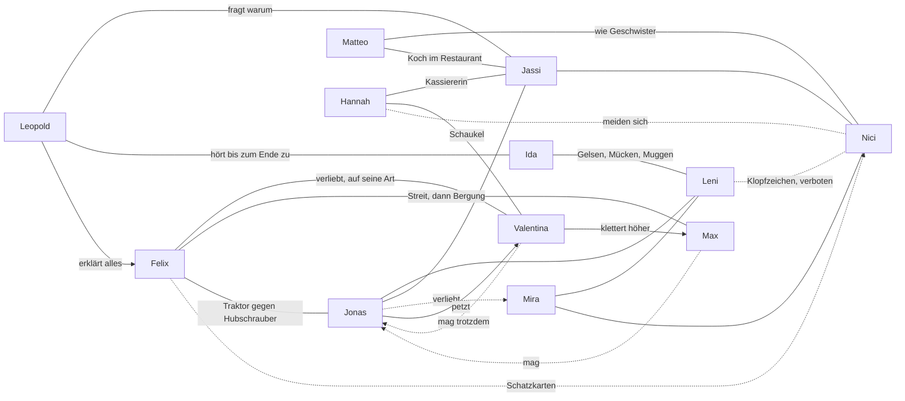
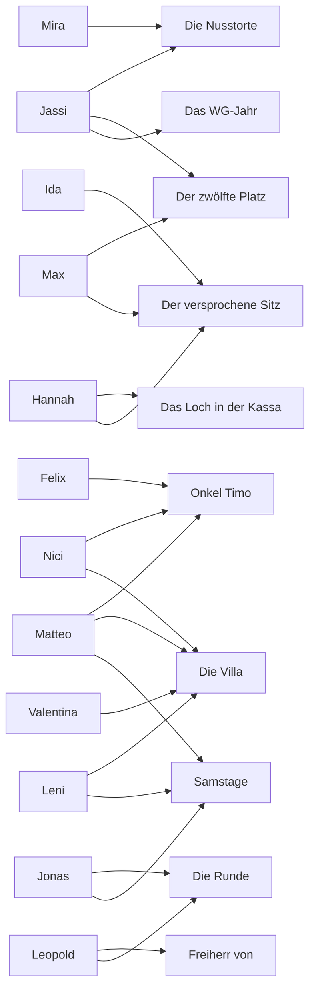

# Beziehungsnetz

Wer zu wem gehört, wer wem etwas schuldet, wer was weiß. Ein Klick auf einen Namen öffnet das Dossier.

**Legende:**
- Durchgezogene Linie: sichtbar, offiziell.
- Gepunktete Linie: heimlich, oder nur gefühlt.
- Dicker Pfeil: Geld.

## 1. Der Council: wie er sich zeigt, und wem er wirklich dient

- **Gezeigt:** 4:3 für Pichler.
- **Wie Susanne zählt:** 5:2. Brunner hat es ihr im Vertrauen gesagt.
- **Wahr:** 3:4 gegen sie.
- **Wie Timotheus zählt:** 4:3. Zu knapp für ihn.
- **Sway** ist kein Stimmrecht. Die beiden Köpfe wiegen gleich, 3:3, die Vorstandspaare auch, 5:5.

## 2. Die Familien draußen

- **Behrens, Plattner, Haidacher:** dreimal derselbe Sitz versprochen. Keine Familie weiß von den anderen. Siehe [[Der versprochene Sitz]].
- **Sepp** hält zu Gruber als Gläubiger, **Monika** zur Freifrau, nicht zum Freiherrn.

## 3. Ehen und Herzen

- **[[Onkel Timo]]:** die Affäre. **[[Samstage]]:** noch keine.
- **Ob die Holzknechts und die Eders zusammenbleiben,** hängt von Lo ab. Beide Wege sind möglich.

## 4. Geld

## 5. Brücken zwischen drinnen und draußen

## 6. Die Kinder

Eine Linie ohne Pfeil ist eine beidseitige Freundschaft im Spiel (`likedKids`, beide Richtungen). Eine gepunktete Linie mit Pfeil heißt: mag, aber nicht zurück. Ein beschrifteter Pfeil ist eine Beziehung ohne Freundschaft. Entschieden in #155 am 2026-10-20.

**Die Freundschaften im Spiel** (beidseitig):

| # | Beidseitig | Begründung aus den Dossiers |
|---|---|---|
| 1–5 | Mira–Leni, Mira–Nici, Jonas–Leni, Jonas–Jassi, Jassi–Nici | Kanon, bleibt. |
| 6 | Matteo–Nici | Matteo wohnt im Souterrain der Gruber-Villa, Nici darüber. Sie spielen, als wären sie Geschwister, und Nici isst oft bei den Pixners unten. |
| 7 | Matteo–Jassi | Matteo will Koch in Jassis Restaurant am Kaufladen sein. |
| 8 | Hannah–Jassi | Jassi kocht, Hannah kassiert, im selben Restaurant. |
| 9 | Hannah–Valentina | Freundinnen zum Schaukeln. Nebenbei schuldet der Baron beiden Vätern Geld oder hat ihnen geschadet; die Mädchen wissen es nicht. |
| 10 | Felix–Valentina | Felix bewundert, wie sie klettert, er selbst kommt nur bis zur zweiten Sprosse. Sie lässt ihn mitklettern, bis zur Hälfte. |
| 11 | Felix–Max | Sie streiten, wem das Klettergerüst gehört, und spielen dann doch zusammen Bergung. |
| 12 | Felix–Jonas | Zwei Fahrzeug-Buben: Traktor gegen Hubschrauber, das wird ernsthaft verhandelt. |
| 13 | Leopold–Jassi | Jassi ist die Einzige, die ihn „warum?" fragt und die Antwort auch hören will. Ihre Eltern sind Gegner im Council; die Kinder wissen es nicht. |
| 14 | Ida–Leni | Beide sind neu und nicht von hier. Leni sagt Gelsen, Ida Mücken, die anderen Muggen. |
| 15 | Ida–Leopold | Sie versteht ihn gut und hört ihm als Einzige bis zum Ende zu. |

- **Einseitig:** Jonas mag Mira (Kanon). Valentina mag Jonas, obwohl er sie verpetzt hat. Max mag Jonas. Felix mag Nici, wegen ihrer Schatzkarten. Einseitiges Mögen ändert im Spiel nichts; es steht für später in den Daten.
- **Wie viele:** Jassi hat fünf Freunde. Nici, Leni, Jonas und Felix haben je drei; Mira, Matteo, Hannah, Valentina, Leopold und Ida je zwei. Max hat einen, Felix; er kommt erst mitten im Lauf und muss zum ersten Mal teilen. Jedes Kind hat mindestens eine beidseitige Freundschaft.
- **Leni und Nici** sind im Spiel nie Freundinnen (fr-055). Durch den Boden schon.
- **Valentina und Max** sind keine Freunde. Wer zuerst am Klettergerüst ist, hält den anderen fern, und Max kommt oft nicht auf „sein" Gerüst.
- **Hannah und Nici** sind keine Freundinnen. Am Maltisch, den beide mögen, sperrt jede die andere aus.
- **Leopold weiß nicht, dass er Freunde hat.** Fragt Lo ihn, sagt er, Jassi und Ida interessierten sich für Geschichte, mehr nicht, und das glaubt er. Jassi und Ida sagen Lo, sie mögen ihn, weil er immer etwas Interessantes weiß und alles nett und geduldig erklärt. Jassi ist sich nicht sicher, ob er sie auch mag, und glaubt, er wisse nicht, dass sie gern seine Freundin wäre. Lo erfährt es über Leopolds eigenes Thema `freunde`, das Idas Tiere-Zeile oder Jassis Anvertrauen beim Mond freischaltet (#155, Q21).

## 7. Wer plaudert was aus

Die Kinder verraten die Geheimnisse der Erwachsenen, ohne es zu wissen.

## 8. Erwachsene, die etwas wissen

| Wer | weiß | über |
|---|---|---|
| [[Maria Kofler]] | wessen Nusstorte es war, frühere Platzkäufe. Ein Foto der Allergieliste. | [[Susanne Pichler]] |
| Elisabeth Lichtenau | wessen Nusstorte es war | Susanne |
| [[Florian Pichler]] | das Kuvert, die Nusstorte | Susanne |
| [[Notburga Hofer]] | wer im WG-Jahr gezahlt hat | Susanne |
| [[Sepp Kirchmair]] | dass Papa Pichler bis heute zahlt | Susanne |
| [[Verena Holzknecht]] | die Bücher, die Kassa, die Belege zum Kuvert | [[Timotheus von Gruber]], Susanne |
| [[Ferdinand Lichtenau]] | das Loch in der Kassa, das Gesetz von 1919 | Timotheus |
| [[Amelie von Gruber]] | die Affäre, die Schulden | Timotheus, Verena |
| [[Monika Pixner]] | den Exekutor, das rote Auto, die Samstage | Timotheus, Verena, [[Thomas Eder]] |
| [[Manni Plattner]] | eine Kopie der Rechnung | Timotheus |
| [[Birgit Eder]] | ahnt eine Frau | Thomas, [[Katharina Brunner]] |
| [[Barbara Aigner]] | dass Florian Schlafmittel nimmt, aber nicht warum | Florian |
